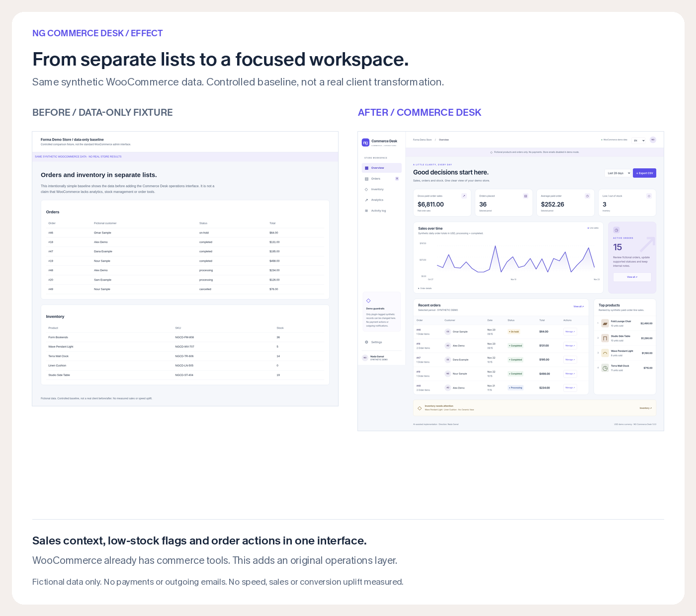
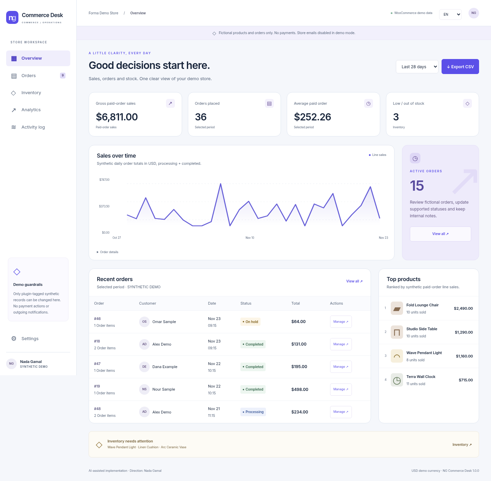
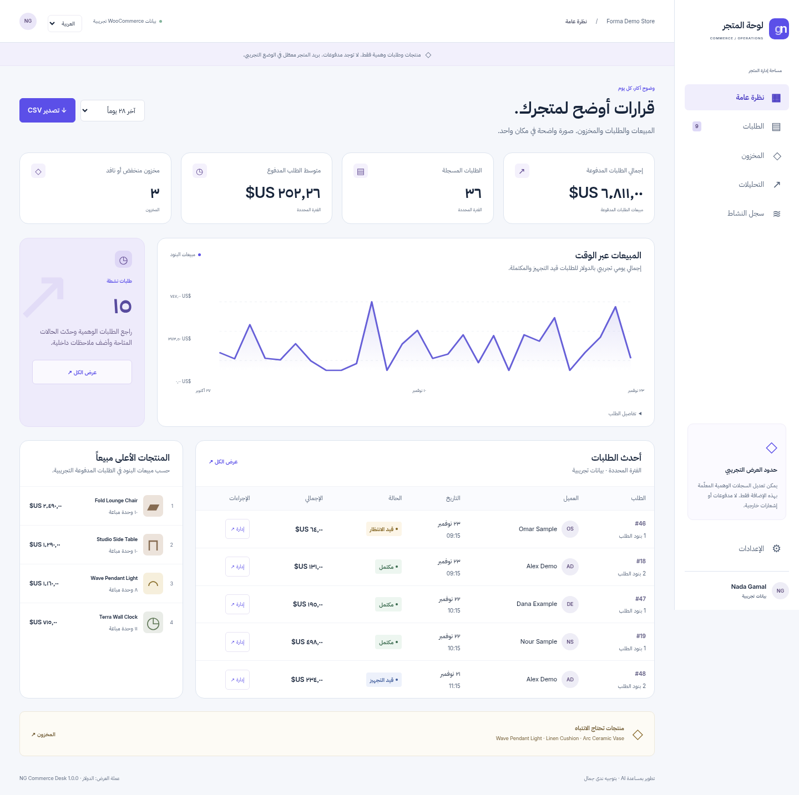
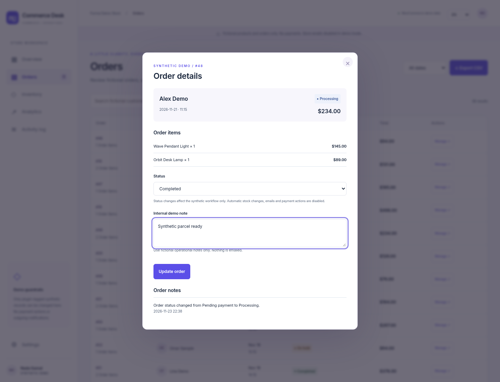
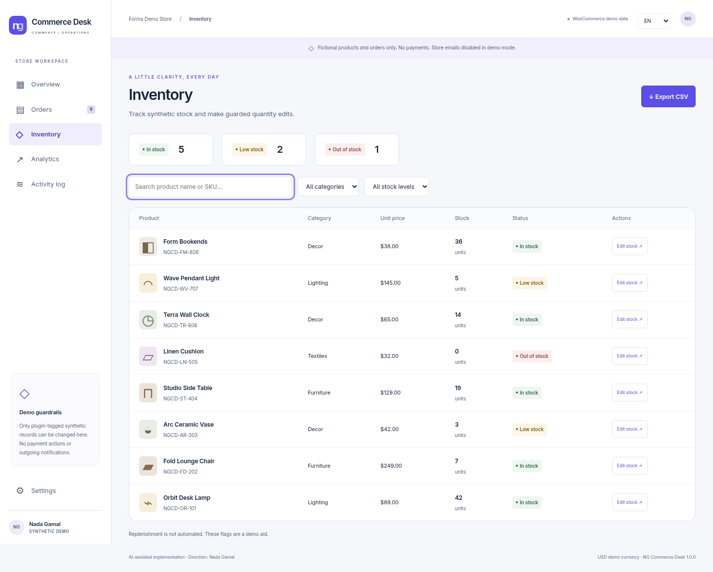
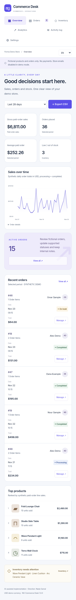
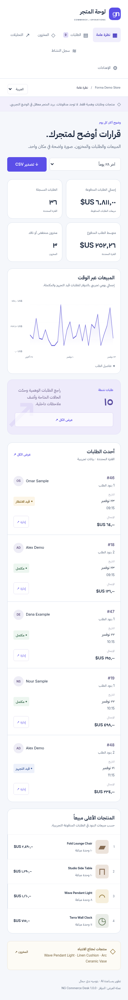
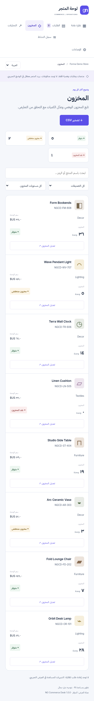
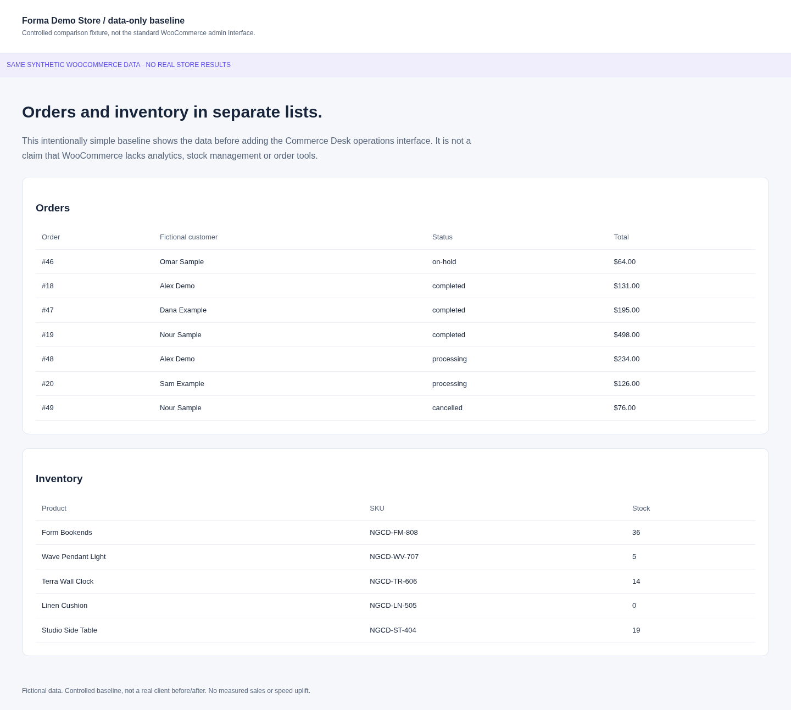

# NG Commerce Desk 1.0.0

A custom WooCommerce operations dashboard, built as a WordPress plugin.
AI-assisted implementation under Nada Gamal's direction, not a claim she wrote
all code. Working synthetic-data portfolio demo, not a production store tool.

## Screenshots

Controlled before/after comparison (same synthetic WooCommerce data; baseline is an intentionally plain fixture, not a real client result):

| Overview (EN) | Overview (AR / RTL) |
|---|---|
|  |  |

| Order details | Inventory |
|---|---|
|  |  |

| Overview (mobile, EN) | Overview (mobile, AR) |
|---|---|
|  |  |

| Inventory (mobile, AR) | Baseline fixture |
|---|---|
|  |  |

The installable plugin source lives in `ng-commerce/`; the optional isolated verification harness is described in `TEST-HARNESS.md`, and `PORTFOLIO-CARD.md` has the short portfolio summary.

## Safety first

Use an **empty isolated LocalWP or staging store only**, never a live shop or the
real Elite Watch store. Setup refuses a site that already contains products or
orders, then creates 8 fictional products and 36 fictional orders. Every mutable
record is tagged as this plugin's synthetic data. Untagged records are rejected.
No real customer details, addresses or payment information are collected.

**While demo mode is active this plugin blocks WordPress wp_mail site-wide and
WooCommerce emails, including unrelated site emails.** This is intentional test
isolation, another reason never to use a real store. Deactivate the plugin to
remove those filters. Demo products are hidden from catalogs and not purchasable.
Status changes in this dashboard do not reduce or restore stock automatically;
edit synthetic inventory explicitly. No gateway charge, refund, shipping label,
email or WhatsApp notification is triggered by the dashboard.

## Install

1. Back up an empty WordPress test site. Install and activate WooCommerce first.
2. Plugins > Add New > Upload Plugin: upload `ng-commerce-desk-1.0.0.zip`.
3. Activate, then open **Commerce Desk** in WordPress admin.
4. Confirm that this is an isolated empty test store and create the synthetic demo.
5. Open the full-screen workspace. It is the site's home URL plus
   `?ng_commerce=1`, protected by WordPress login and `manage_woocommerce`.
6. Switch English / العربية in the header. French and German are optional
   machine-assisted previews and are explicitly marked as not professionally reviewed.

Administrator and WooCommerce shop-manager roles have access. Subscribers and
anonymous visitors do not. The plugin does not create users or passwords.

## Features

- Overview: gross paid-order sales, order count, average paid order and stock flags.
- Analytics: 7-day, 28-day, all-data and custom date ranges; daily chart and data
  disclosure; product ranking by paid-order line sales.
- Orders: search, status filter, supported status transitions and internal notes.
- Inventory: product/SKU search, category/stock filters, quantity edits with
  expected-value conflict detection. Zero stock is separate from low stock.
- Settings: demo label and low-stock threshold, not WooCommerce checkout settings.
- CSV: all synthetic orders or all synthetic inventory. Export scope is labelled
  explicitly, independent of the UI filters. Text formula prefixes are neutralised.
- Activity trail for changes made through this plugin.
- English and Arabic RTL from the start. Separate EN/AR/FR/DE dictionaries,
  matching keys, local font files and no third-party frontend runtime libraries.

## Metric definitions and limits

All displayed figures are calculated from actual WooCommerce objects created by
this demo, not hard-coded UI numbers or real merchant results. USD is the fixed
demo currency. "Gross paid-order sales" sums order totals whose current status is
processing or completed and whose creation date is in the selected period. This
is not a financial statement, net revenue, cash-flow report or refund-adjusted
WooCommerce Analytics replacement. Average divides that total by paid-order count.
Top-product line sales exclude order-level shipping/tax. Seed orders have no tax,
shipping, discounts or refunds. Dates use the WordPress store timezone.

This demo reads at most 100 tagged products and 200 tagged orders, caches its
snapshot for 30 seconds and invalidates on its own writes. Changes made elsewhere
may appear after cache expiry. No pagination/large-store performance claim. No
reserving or checkout flow, refunds, customer contact, multi-currency, fulfilment,
variation editor, bulk stock import or real accounting integrations.

Supported order changes: pending/on-hold → processing or cancelled; processing →
completed or cancelled. Completed and cancelled are terminal in this UI. Notes can
be added without a status change. Writes through this plugin use a per-record lock
and expected stock/order revision, not a database-wide transaction across external
WooCommerce edits. Locks are not a full concurrent multi-system commerce solution.

## Effect: before and after

Before: the controlled comparison fixture displays the same synthetic order and
inventory data in separate plain lists. After: Commerce Desk adds a focused
operations workspace with period metrics, stock flags, search, filters and guarded
edits. **The baseline is intentionally constructed, not a screenshot of standard
WooCommerce and not a real client's old site.** WooCommerce already has orders,
stock tools and analytics. This plugin adds its own combined workflow and design;
it does not claim those capabilities are missing from WooCommerce.

Premium details: original light admin surfaces, indigo emphasis, consistent cards,
clear status labels, 44px primary controls, mobile stacked tables, IBM Plex Sans
Arabic/Inter bundled locally, RTL layout, explicit empty/error/loading/disabled
states and reduced-motion support. Product tiles use original abstract icons,
not product photography. It does not redesign the public storefront.

Speed: no third-party scripts, remote fonts or images in the plugin interface;
30-second cached bounded data reads. No speed benchmark or sales/conversion/time
uplift has been measured. Local fonts still incur same-origin asset requests.

Security: permission checks on every custom REST route, WP REST nonces on writes,
server-side validation/sanitisation, escaped UI strings, synthetic-tag restrictions,
conflict checks and CSV text-prefix protection. This is not a full security audit,
PCI/compliance certification or permission to connect a live shop.

## Verified compatibility

Tested: WordPress 7.1.5, WooCommerce 11.3.1, PHP 8.3.36, SQLite integration in
WordPress Playground, headless Google Chrome. WooCommerce CRUD APIs are used,
not direct order-table SQL. HPOS-specific mode, MySQL/MariaDB, other themes,
Elementor/Bricks editors, other plugins, multisite and production load have not
been tested. Nothing here promises universal compatibility. No clinic integration.

## Development

`includes/class-demo.php`: isolated seeding, synthetic tagging, simulation log.
`includes/class-api.php`: restricted REST layer, export and guarded mutations.
`includes/class-plugin.php`: WP integration, screen, assets and demo guardrails.
`assets/app.js`: dependency-free interface; `assets/locales/`: locale dictionaries.

French/German labels are machine-assisted. Product names, category names,
WooCommerce-generated notes and some server errors remain English. This is
internationalisation-ready UI, not a claim of complete professional localisation.

## Data retention / removal

Deactivation retains the demo objects and settings and removes runtime filters.
Deletion also retains them deliberately, to avoid silently deleting WooCommerce
order history. In an isolated demo, reset/delete the entire disposable test site
when finished. Do not reuse this demo site as a real store. No uninstall-time
object deletion is claimed. Backups may retain older demo records.

## License and credit

GPL-2.0-or-later. Inter and IBM Plex Sans Arabic are bundled under their respective
OFL font licenses in assets/fonts/. Original interface and abstract product tiles.
No reference website assets or code are copied. Screenshots and full reproducible
verification harness are in the companion source bundle. See TEST-REPORT.md.
